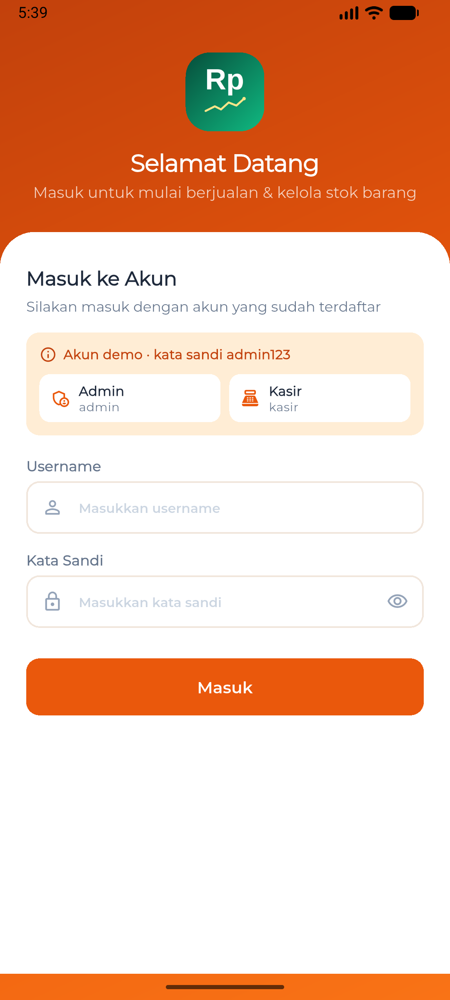
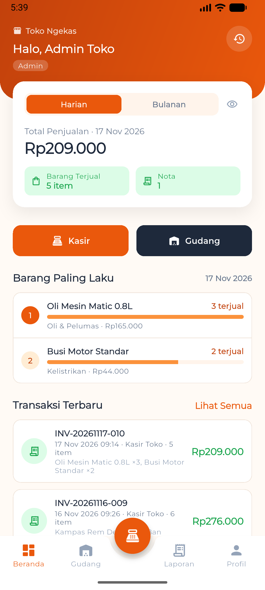
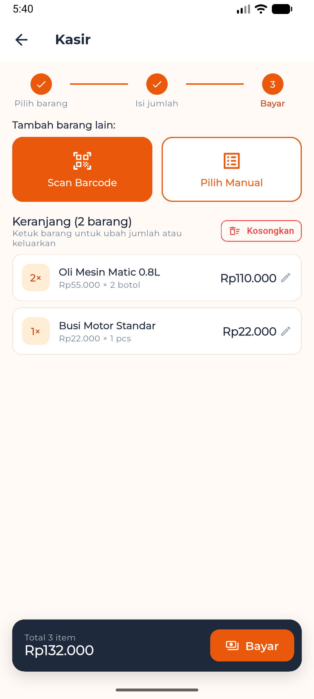

<div align="center">


# Ngekas

Aplikasi kasir dan stok barang buat toko kecil.
Jualan, cek stok, sampai laporan, cukup dari HP.

<br />


&nbsp;&nbsp;

&nbsp;&nbsp;


<sub>Login &nbsp;·&nbsp; Beranda &nbsp;·&nbsp; Kasir</sub>

</div>

## Kenapa Ngekas

**Kasir yang gampang dipakai siapa aja**
Cuma 3 langkah: pilih barang, isi jumlah, bayar. Kembalian langsung dihitung, dan struknya bisa dikirim ke pelanggan lewat WhatsApp dalam bentuk gambar.

**Scan barcode langsung dari kamera HP**
Ga perlu alat scanner tambahan. Satu barang bisa punya beberapa barcode, misalnya kemasan lama dan kemasan baru. Kalau yang discan barcode dus, jumlahnya otomatis dihitung sesuai isinya (1 dus = 12 botol). Ketemu barcode yang belum terdaftar? Bisa langsung dihubungkan ke barangnya dari layar kasir.

**Stok selalu sesuai**
Stok berkurang sendiri tiap ada penjualan. Setiap barang punya kartu stok yang mencatat barang masuk, keluar, dan penyesuaian beserta alasannya (barang datang, stock opname, rusak). Barang yang mau habis atau sudah habis langsung kelihatan.

**Laporan yang langsung kepakai**
Omzet harian, bulanan, atau rentang tanggal sendiri. Ada laba kotor, rekap per barang, dan filter per kategori atau kasir. Laporannya bisa diexport ke PDF untuk dicetak atau dibagikan.

**Tahu barang mana yang ga laku**
Laporan stok menunjukkan barang yang habis, menipis, dan yang ga terjual sama sekali dalam 30 hari terakhir.

**Input barang banyak sekaligus**
Data barang bisa diimport dari file Excel atau CSV. Sebelum disimpan, tiap baris dicek dulu dan ditampilkan mana yang siap, dilewati, atau error.

**Akses admin dan kasir dipisah**
Admin pegang semuanya. Kasir fokus jualan dan ga bisa ubah harga atau hapus data. Akun kasir dibuat oleh admin.

**Semua perubahan tercatat**
Riwayat aktivitas mencatat siapa yang menambah, mengubah, atau menghapus data, lengkap dengan nilai lama dan barunya.

## Coba Jalankan

```bash
flutter pub get
flutter run
```

Login pakai akun demo `admin` atau `kasir`, kata sandinya `admin123`.
